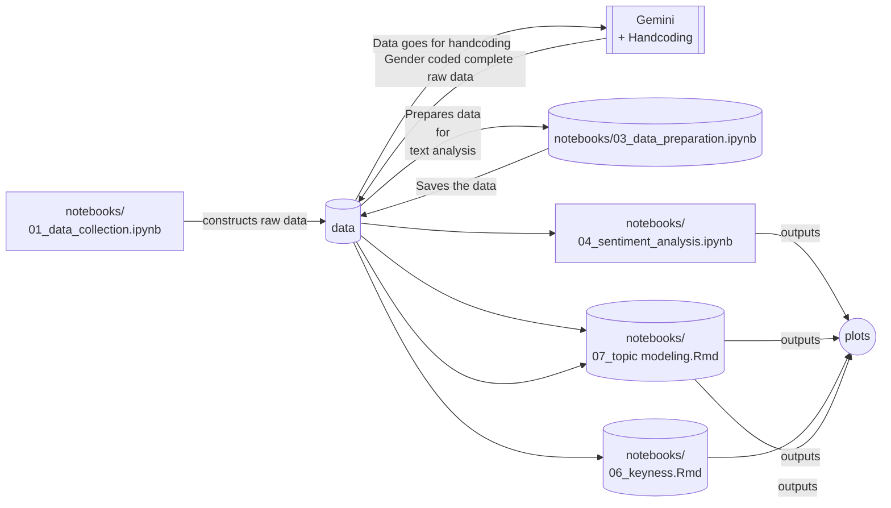

# Audience_Discourse_Gender_Stereotype

This repository contains codes to reproduce the results of the research paper "Gender Stereotypes in Social Media Audience Discourse: Evidence from Bangladeshi Artists". Python is used to collect and clean data, and both Python and RStudio for text analysis. I have mentioned the runtime of each computationally expensive codes on top of it and the reproduction of the research requires following the file sequence in the `notebooks` folder. 

***This project uses a virtual environment (venv) to isolate dependencies and prevent system library conflicts. Instructions to recreate the environment and initialize the Jupyter kernel are provided in the first notebook within the notebooks/ folder.***

The following mermaid plot illustrates the data journey,

## Softwares and packages
Data collection and pre-processing were done using python 3.9 and the libraries langdetect,spellchecker, wordfreq, avro, googletrans, nltk, matplotlib, spacy, datetime and seasborn. Data analysis was done using the packages ‘quanteda’, ‘quanteda. textstats’, ‘quanteda. dictionaries’, ‘quanteda. textplots’, ‘stm’, ‘tidyverse’, ‘pyLDAvis’ and ‘zoo’ (Benoit et al. 2018) (Roberts et al., 2019) in the statistical software RStudio version 2022.07.02 (Team, 2021) .  

## Reproduction Time
Data collection required 7 days, followed by gender and art coding. The Gemini API pipeline took two days to complete the initial automated coding, while the subsequent manual validation phase required nearly a month. The most computationally expensive segment of data processing involved translation and transliteration; these scripts were executed continuously in parallel with the manual validation and finalization of the art and gender categories.
As a result, reproduction time will vary significantly based on individual researcher workflows, though the core analysis took approximately one month to complete.

_**Note:** Due to YouTube's data retention policies, the raw corpus collected in October 2026 cannot be stored or publicly shared. Executing this repository at a different point in time will retrieve a new data snapshot, which will inherently alter the research findings.
However, the processed analytical data remains storable for up to 32 months. Within this timeframe, the processed dataset can be supplied upon request to facilitate the exact reproduction of the findings presented in this paper. contact: dhiraanan3@gmail.com_

***Privacy policy: https://tahiaanandhira.com/privacy.html*** 

